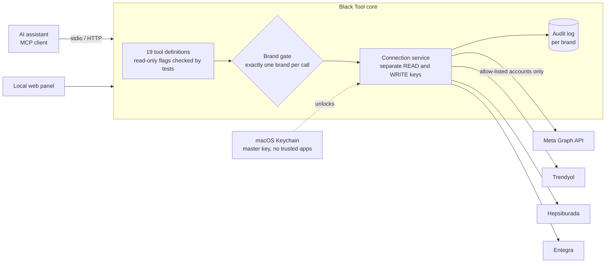
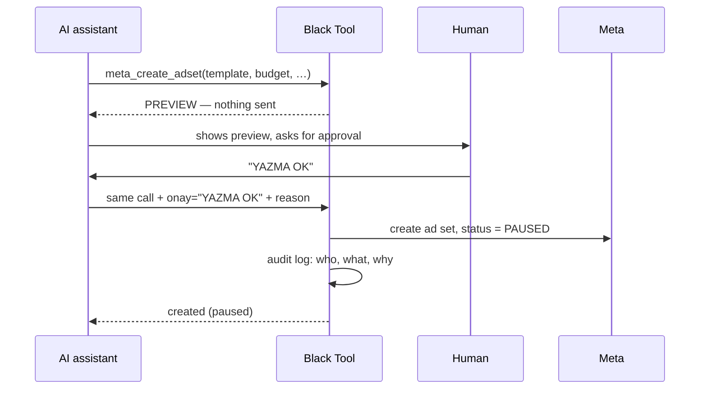

# Black Tool

**A brand-isolated MCP gateway that lets an AI assistant read client ad and marketplace accounts — and write only behind an exact approval phrase**

Black Wool Project · **Project Lead & Developer** · [Türkçe](README.tr.md)

> **About this repository.** Black Tool is an internal tool of Black Wool, which runs advertising
> and marketplace operations for several client brands. Its source code is private; this is a case
> study. Client brands are not named.

---

## At a glance

| | |
|---|---|
| **What it is** | An MCP (Model Context Protocol) server plus a local web panel, both over the same data |
| **Platforms** | Meta (ads) · Trendyol · Hepsiburada · Entegra |
| **Tools** | 19 tools exposed to the AI assistant: 16 read-only, 1 that changes only Black Tool's own database, 2 that write to a client's Meta account |
| **Writes so far** | 9 approved write operations on real client accounts (campaign shells and ad sets), every one created **paused** |
| **Panel** | Overview, brands, connections, ads, marketplace, products, order and product questions, approval box |
| **Codebase** | ~5,900 lines of server TypeScript · ~4,600 lines of panel code · 47 test files / 424 test cases · 415 commits |

Measured from the repository on 28 Oct 2026. The write count comes from the project's own approval log.

---

## The problem

Black Wool manages ad accounts and marketplace stores for several brands. Questions like *"how did
yesterday's campaigns do for brand X?"*, *"are there unanswered product questions?"* or *"open two
new ad sets like last month's"* meant switching between four platforms and several logins per brand.

Connecting an AI assistant to all of that is useful and dangerous in equal measure. One brand's
request must never touch another brand's account, a read must never accidentally run with write
permissions, and nothing should change in a client's account unless a human said so, in words,
for that one operation.

## What I built

One core serves two entry points — the MCP server the assistant talks to, and a local panel for
people — so the assistant and the human see exactly the same data.

---

## Engineering decisions

### 1. Every call belongs to exactly one brand

Each tool call carries one brand. The connectors hold that brand's **allow-list** of accounts; an
account that is not on it is rejected **before any network request**, and the attempt is logged to
that brand's audit trail. A separate check compares what Meta says the access token can reach with
the allow-list, so a token that suddenly sees an extra client account is visible on the panel.

### 2. Reading and writing use different keys

Each brand has separate read and write connections. The only way to reach a write key is one
dedicated method, and if no active write connection exists it **fails** — it never falls back to the
read key, and a read can never silently run with write permissions.

### 3. Writes need an exact phrase, and default to a preview

The two Meta write tools (create a campaign, create an ad set copied from an existing one) produce
a **preview only** unless the call includes the exact phrase `YAZMA OK` ("write OK"). Every write
also requires a written justification that goes into the audit log, and everything created starts
as **PAUSED**, so a person turns it on in Meta after checking it. Budgets are entered in lira and
converted to Meta's minor units by the tool, not by the model.

### 4. Claims about safety are tests, not sentences

The panel says how many tools write. That sentence would silently become false the day a writing
tool is added — so a test lists the approved writers by name and **fails the build** if any other
tool is not marked read-only. Tool annotations are typed as plain booleans precisely so this count
can be computed (a literal `false` type made the comparison impossible to compile). The same idea
applies to the panel's "no requests sent to Trendyol and Hepsiburada yet" line: it is counted from
the request log, not written by hand.

### 5. Secrets are guarded at rest and at unlock

Platform credentials are stored encrypted with AES-256-GCM. The master key is not in a `.env` file:
it lives in the macOS Keychain in an entry that trusts **no application**, so every read opens a
confirmation dialog on the owner's screen — neither an agent nor an injected command can take it
silently.

### 6. Platform responses are validated, not coerced

An early version converted platform numbers with `Number(...)` and wrote `0` when a value could not
be parsed — so a changed API response looked like a day with no spend. Responses now pass a
validator that checks the expected shape; anything unexpected is an error, not a zero. Stored
campaign data goes through a field **allow-list**.

---

## Tech stack

| Layer | Technology |
|---|---|
| Server | TypeScript on Node 24 (type stripping, no build step), Model Context Protocol over stdio and HTTP |
| Data | SQLite, AES-256-GCM credential encryption, macOS Keychain for the master key |
| Panel | React + Vite, own design tokens with a contrast check |
| Quality | 47 test files / 424 cases; one `dogrula` command runs types, tests, panel build, panel/server separation check and documentation checks |
| Delivery | Runs on the operator's machine; Dockerfile and compose file prepared for server deployment |

---

## My role

I designed and built Black Tool for Black Wool: the brand-isolation model, the connectors to all
four platforms, the MCP tool set and its safety rules, the encryption and key handling, the panel
and the test suite — and I operate it, approving each write myself.

## What is not in this repository

Source code, credentials, client names, account IDs and any client data.
