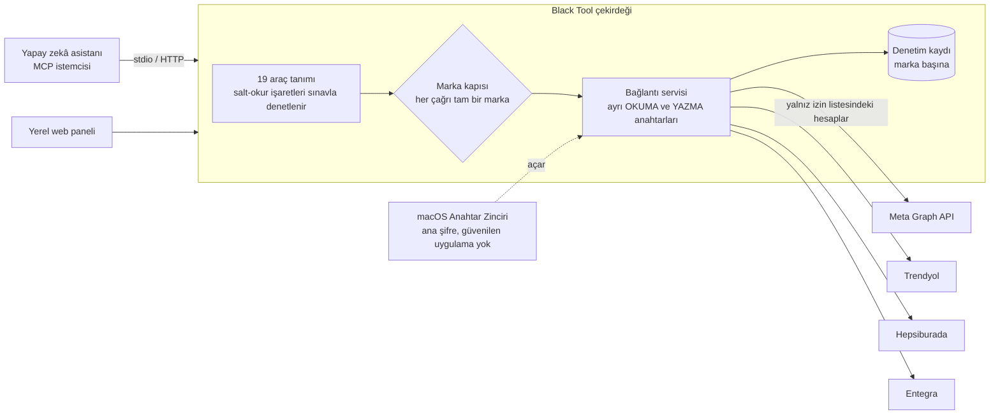
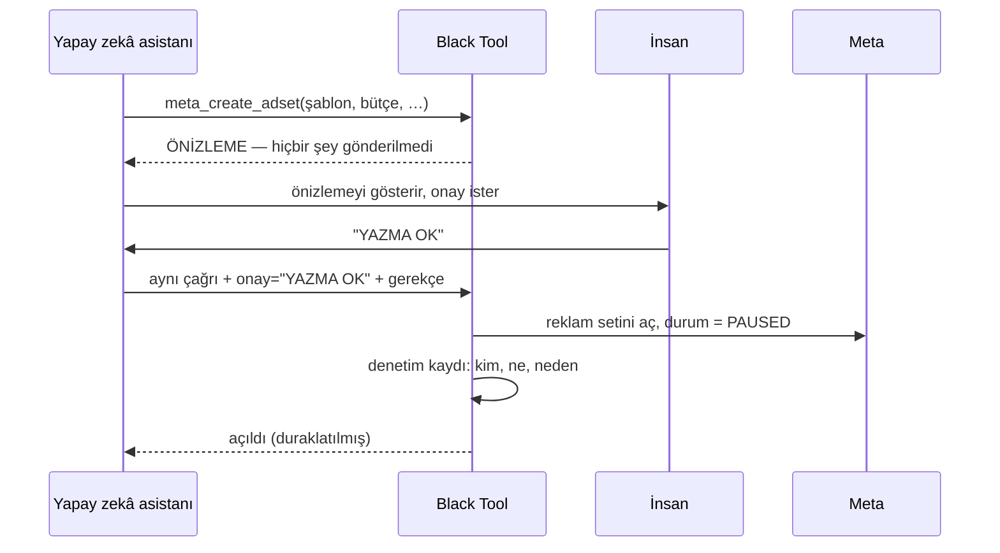

# Black Tool

**Yapay zekâ asistanının müşteri reklam ve pazaryeri hesaplarını marka marka ayrılmış hâlde okuduğu — ve yalnız birebir onay sözüyle yazabildiği — MCP geçidi**

Black Wool Project · **Project Lead & Developer** · [English](README.md)

> **Bu depo hakkında.** Black Tool, birkaç müşteri markasının reklam ve pazaryeri operasyonunu
> yürüten Black Wool'un iç aracı. Kaynak kodu gizli; bu bir vaka çalışmasıdır. Müşteri markalarının
> adı verilmiyor.

---

## Özet

| | |
|---|---|
| **Ne** | Bir MCP (Model Context Protocol) sunucusu ve aynı veriyi gösteren yerel bir web paneli |
| **Platformlar** | Meta (reklam) · Trendyol · Hepsiburada · Entegra |
| **Araçlar** | Yapay zekâ asistanına açık 19 araç: 16'sı yalnız okur, 1'i yalnız Black Tool'un kendi veritabanını değiştirir, 2'si müşterinin Meta hesabına yazar |
| **Bugüne kadarki yazmalar** | Gerçek müşteri hesaplarında 9 onaylı yazma işlemi (kampanya kabukları ve reklam setleri), hepsi **duraklatılmış** açıldı |
| **Panel** | Genel bakış, markalar, bağlantılar, reklam, pazaryeri, ürünler, sipariş ve ürün soruları, onay kutusu |
| **Kod tabanı** | ~5.900 satır sunucu TypeScript'i · ~4.600 satır panel kodu · 47 sınav dosyası / 424 sınav durumu · 415 commit |

28 Ekim 2026'da depodan ölçüldü. Yazma sayısı projenin kendi onay kaydından.

---

## Sorun

Black Wool birkaç markanın reklam hesaplarını ve pazaryeri mağazalarını yönetiyor. *"X markasının dünkü
kampanyaları nasıldı?"*, *"cevapsız ürün sorusu var mı?"* ya da *"geçen ayki gibi iki yeni reklam seti
aç"* gibi sorular, marka başına dört platform ve birkaç giriş arasında gidip gelmek demekti.

Bir yapay zekâ asistanını bunların hepsine bağlamak ne kadar yararlıysa o kadar tehlikeli. Bir markanın
isteği başka bir markanın hesabına asla dokunmamalı, bir okuma yanlışlıkla yazma yetkisiyle çalışmamalı
ve bir insan o tek işlem için sözle "evet" demedikçe müşterinin hesabında hiçbir şey değişmemeli.

## Ne yaptım

Tek bir çekirdek iki girişe hizmet ediyor — asistanın konuştuğu MCP sunucusu ve insanlar için yerel
bir panel — böylece asistan ve insan tam olarak aynı veriyi görüyor.

---

## Mühendislik kararları

### 1. Her çağrı tam olarak bir markaya ait

Her araç çağrısı tek bir marka taşıyor. Bağlayıcılar o markanın hesap **izin listesini** tutuyor;
listede olmayan bir hesap **hiçbir ağ isteği yapılmadan** reddediliyor ve deneme o markanın denetim
kaydına yazılıyor. Ayrı bir kontrol, Meta'nın erişim belirtecinin gerçekte nelere ulaşabildiğini izin
listesiyle karşılaştırıyor; birden fazladan bir müşteri hesabı gören belirteç panelde görünür oluyor.

### 2. Okuma ve yazma farklı anahtarlarla yapılıyor

Her markanın ayrı okuma ve yazma bağlantıları var. Yazma anahtarına ulaşmanın tek yolu ayrı bir
metot ve aktif bir yazma bağlantısı yoksa **düşüyor** — asla okuma anahtarına dönmüyor; bir okuma da
hiçbir zaman sessizce yazma yetkisiyle çalışamıyor.

### 3. Yazma birebir söz istiyor, varsayılanı önizleme

İki Meta yazma aracı (kampanya açma, var olan bir setten kopyalanarak reklam seti açma), çağrıda
birebir `YAZMA OK` sözü yoksa **yalnız önizleme** üretiyor. Her yazma ayrıca denetim kaydına giden
yazılı bir gerekçe istiyor ve açılan her şey **PAUSED (duraklatılmış)** başlıyor; bir insan kontrol
edip Meta'da açıyor. Bütçeler lira olarak giriliyor ve Meta'nın kuruş birimine çeviriyi model değil
araç yapıyor.

### 4. Güvenlik iddiaları cümle değil, sınav

Panel kaç aracın yazdığını söylüyor. Bu cümle, yazan bir araç eklendiği gün sessizce yanlış olurdu —
bu yüzden bir sınav onaylı yazanları adlarıyla listeliyor ve başka bir araç salt-okur işaretli değilse
**derlemeyi düşürüyor**. Araç işaretleri bu sayım yapılabilsin diye düz `boolean` olarak tiplendi
(sabit `false` tipi karşılaştırmayı derlenemez yapıyordu). Aynı fikir panelin "Trendyol ve Hepsiburada'ya
henüz istek gitmedi" satırında da var: elle yazılmıyor, istek kaydından sayılıyor.

### 5. Sırlar hem dururken hem açılırken korunuyor

Platform kimlik bilgileri AES-256-GCM ile şifreli saklanıyor. Ana şifre bir `.env` dosyasında değil:
macOS Anahtar Zinciri'nde **hiçbir uygulamaya güvenmeyen** bir kayıtta duruyor; böylece her okuma
sahibin ekranında bir onay penceresi açıyor — ne bir ajan ne de içeri sızmış bir komut onu sessizce
alabiliyor.

### 6. Platform cevapları zorla çevrilmiyor, doğrulanıyor

İlk sürüm platform sayılarını `Number(...)` ile çeviriyor ve çevrilemeyen değere `0` yazıyordu —
yani değişmiş bir API cevabı harcamasız bir gün gibi görünüyordu. Cevaplar artık beklenen şekli
denetleyen bir doğrulayıcıdan geçiyor; beklenmeyen her şey sıfır değil hata. Saklanan kampanya
verisi bir alan **izin listesinden** geçiyor.

---

## Teknolojiler

| Katman | Teknoloji |
|---|---|
| Sunucu | Node 24 üzerinde TypeScript (tip ayıklama, derleme adımı yok), stdio ve HTTP üzerinden Model Context Protocol |
| Veri | SQLite, AES-256-GCM kimlik bilgisi şifreleme, ana şifre için macOS Anahtar Zinciri |
| Panel | React + Vite, kontrast denetimli kendi tasarım belirteçleri |
| Kalite | 47 sınav dosyası / 424 durum; tek `dogrula` komutu tipleri, sınavları, panel derlemesini, panel/sunucu ayrım denetimini ve belge denetimlerini çalıştırıyor |
| Dağıtım | Operatörün bilgisayarında çalışıyor; sunucuya kurulum için Dockerfile ve compose dosyası hazır |

---

## Rolüm

Black Tool'u Black Wool için tasarlayıp geliştirdim: marka ayrımı modeli, dört platformun
bağlayıcıları, MCP araç seti ve güvenlik kuralları, şifreleme ve anahtar yönetimi, panel ve sınav
takımı — ve her yazmayı kendim onaylayarak işletiyorum.

## Bu depoda olmayanlar

Kaynak kod, kimlik bilgileri, müşteri adları, hesap kimlikleri ve hiçbir müşteri verisi.
